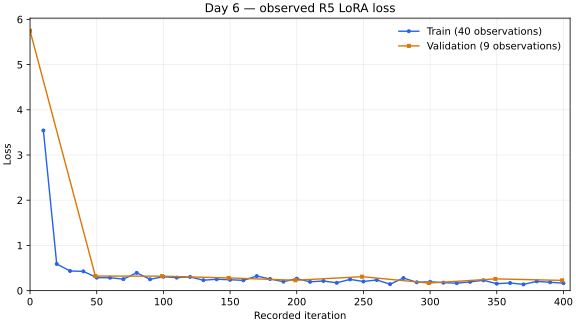

# Day 6 — первый тюн на готовом датасете

## Задание и результат

Пройти обучение от начала до конца: выбрать готовый HF dataset с заметным изменением
поведения, изучить примеры и привести их к шаблону модели; выбрать небольшую модель
и доступное железо; выполнить LoRA/QLoRA, наблюдать loss и сохранить адаптер; сравнить
одни и те же 20 запросов до/после, описать изменения и неизменность, найти ухудшения;
зафиксировать параметры и реальное время.

Выполнен один локальный **LoRA**, не QLoRA. Основная оценка — исходные 20 замороженных
held-out запросов. В них строгих регрессий нет. Затем отдельный заранее определённый
probe120 на том же адаптере выявил одну строгую регрессию. Control принял Course Minimum
после R6; содержание и приватность этой документации приняты Control после R7.
Эксперимент не включает публикацию модели или весов адаптера.

## Модель, данные и формат

Модель: [mlx-community/SmolLM2-360M-Instruct](https://huggingface.co/mlx-community/SmolLM2-360M-Instruct),
revision `5d5e6fee5beb5d4d4d85e2203ef23e1230a9aac7`, MLX bf16 без квантования.
Dataset: [dair-ai/emotion](https://huggingface.co/datasets/dair-ai/emotion), configuration
`split`, revision `cab853a1dbdf4c42c2b3ef2173804746df8825fe`.

Задача — английский текст → ровно одно lowercase label из sadness, joy, love, anger,
fear, surprise. Исходные splits: 16000 train / 2000 validation / 2000 test. Для быстрого
учебного запуска использованы 3996 train и 498 validation с детерминированной
стратификацией и удалением exact text duplicates; исходные splits не смешивались.

Chat records содержали system-инструкцию классификации, user-текст и assistant-label.
Использован настоящий tokenizer chat template закреплённой модели. Проверены prefix,
финальный assistant completion, prompt masking и отсутствие truncation при 512 tokens.
Данные и индивидуальные записи не включены в публичную документацию.

## Железо, параметры и обучение

MacBook Pro, Apple M1 Pro, 32 GiB unified memory; macOS 26.5.2, Python 3.13.3, Metal.
Стек: mlx 0.32.4, mlx-lm 0.32.2, datasets 4.8.5, huggingface_hub 1.33.0,
transformers 5.21.0. [Полные публикуемые параметры](DAY6_RUN_PARAMETERS.json).

| Параметр | Значение |
|---|---|
| Метод / optimizer | LoRA / Adam |
| Iterations / batch | 400/400 / 4 |
| Learning rate | 0.0001 |
| Слои | последние 8 |
| Rank / scale / dropout | 8 / 20 / 0 |
| Target modules | self_attn.q_proj, self_attn.v_proj |
| Max sequence / mask prompt | 512 / true |
| Seed обучения | 20261027 |
| Отчёт train / validation | каждые 10 / 50 итераций |
| Validation batches / save interval | 10 / 100 |

Реальный training worker завершился с exit code 0. Измеренное wall time —
**90.590454 s**, включая загрузку модели и финальные проверки worker. Это не отдельный
замер чистого GPU compute и не время полного workflow с установкой и подготовкой данных.

Train loss: **3.542339 → 0.165222**, 40 logged points. Validation loss:
**5.746957 → 0.226833**, 9 logged points. Промежуточные значения могут расти.

На графике показаны все подтверждённые точки по реальным записанным iteration indices:
train 10–400, validation 0–399. Соединяющие отрезки служат ориентиром, не добавляют
измерений между точками. Сглаживание не применялось.

Адаптер реально сохранён, заново загружен и использован в tuned generation. Проверены
целостность и совпадение загруженных тензоров. Веса и индивидуальное машинное evidence
остаются приватными; публичная модель или download адаптера здесь не предоставляются.

## Primary R5 — исходные 20

Одни и те же 20 held-out test inputs заморожены до первого Base вывода; Base выполнен
до train. После train использованы та же модель/revision, template и system-инструкция,
те же inputs и decoding; отличие — сохранённый адаптер. Greedy, temperature=0,
max_new_tokens=12, seed=20261027. Без trim или извлечения label из объяснения.

| Primary20 | Base | Fine-tuned |
|---|---:|---:|
| Strict correct | 1/20 (5,0%) | 12/20 (60,0%) |
| Exact one-label format | 5/20 (25,0%) | 20/20 (100%) |

Изменились 18 ответов; raw unchanged — 2. Строго улучшились — 11; strict regressions —
**0**; изменились, оставаясь строго неправильными, — 7. Это наблюдаемое улучшение на
данных 20 запросах, не оценка общей надёжности.

## Supplemental R6 — отдельный balanced probe120

Дополнительные 120 уникальных примеров взяты только из официального test, по 20 на
каждый класс, seed selection=20261028. До inference исключены исходные 20 по index/hash
и все exact text совпадения с полными train/validation; выполнен dedup. Весь sample,
протокол и tokenization заморожены до Base. Состав не менялся после просмотра ответов.

R6 — **только inference**, без обучения или обновления адаптера. Model revision,
template, decoding и R5 адаптер сохранены. Все 120 Base и 120 tuned outcomes учтены.

| Supplemental120 | Base | Fine-tuned |
|---|---:|---:|
| Strict correct | 11/120 (9,2%) | 82/120 (68,3%) |
| Exact one-label format | 21/120 (17,5%) | 120/120 (100%) |

Строгих улучшений — 72; strict regressions — **1**; raw unchanged — 14; изменились,
оставаясь строго неправильными, — 33. Следовательно, реально наблюдался один случай,
где Base был строго верен, а tuned — неверен. Сам случай проверен в приватном evidence;
его текст, ID, tokens и индивидуальные ответы здесь не публикуются.

## Методология, ограничения и статусы

Strict correct = raw буквально равен gold. Strict format = raw ровно одно из шести
labels. Strict regression = Base correct AND tuned incorrect. Changed wrong→wrong
не считается strict regression. Пунктуация, пробелы и объяснения не нормализуются.

Primary20 и supplemental120 **не объединяются** в accuracy или единую исходную оценку.
Первичная выборка мала; дополнительная сбалансирована по классам и исследовательская,
не представляет естественное распределение. Эмоции могут быть неоднозначны; strict
label matching не измеряет всю семантическую корректность. Результат демонстрирует
изменение поведения в этих тестах, но не доказывает generalization или production quality.

Course Minimum: ACCEPTED решением Control после R6. Содержание и приватность
документации приняты Control после R7. Публикация модели и весов адаптера не входит
в результат эксперимента. Новых train/inference при подготовке R7 не было.

Лицензии, закреплённые источники и bibliographic attribution:
[DAY6_PRIVACY_LICENSE_RU.md](DAY6_PRIVACY_LICENSE_RU.md).
