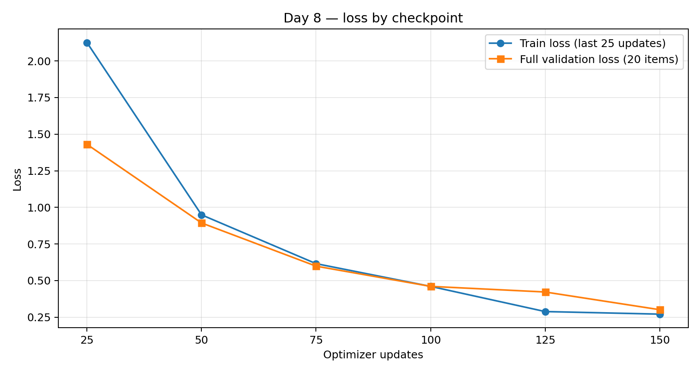

# Day 8 — Limits of Fine-Tuning (Bublik Advanced)

**Status:** G4 results accepted by independent Control Review; publication staging for separate approval (not published). Owner OOD adjudication remains PENDING. 30 October 2026.

## Question

What can a small model learn from fine-tuning, and what remains better solved with a prompt or context? Do we see generalization losses or overfitting when training improves the task-specific output?

## Setup

- Local **SmolLM2-360M-Instruct**, fixed base revision `5d5e6fee5beb5d4d4d85e2203ef23e1230a9aac7`. Fresh LoRA training on Mac M1 Pro, 32 GB; **150 optimizer updates**, 96 train examples, 20 validation examples.
- A locked 40-item evaluation: 8 developer-request JSON routing (**format**), 8 constrained written outputs (**style**), 12 knowledge probes of six invented project facts (**6 direct / 6 paraphrases**), and 12 short **out-of-domain** common-knowledge/arithmetic probes.
- Primary arms: **Base**, **Base+Prompt**, **TunedBest**. Additional **Base+Facts** (knowledge-only, 12) and **TunedLate** (same best/late checkpoint in this run).
- Scoring was frozen before training. JSON requires exact label and target, style and factual code are exact-match, OOD has NFKC/case/whitespace normalization but rejects extra punctuation or explanations. Supplementary human content review does *not* replace strict metrics.

## Results

| Arm | Overall | JSON format | Style | Knowledge probes | OOD (strict) |
|---|---:|---:|---:|---:|---:|
| Base | **1/40 (2.5%)** | 0/8 | 0/8 | 0/12 | 1/12 |
| Base + good prompt | **1/40 (2.5%)** | 0/8 | 0/8 | 0/12 | 1/12 |
| TunedBest | **11/40 (27.5%)** | 5/8 | 3/8 | 1/12 | 2/12 |
| TunedLate (same step-150 adapter) | **11/40 (27.5%)** | 5/8 | 3/8 | 1/12 | 2/12 |

This is **+25 percentage points** on this narrow strict benchmark. Paired Base vs TunedBest: 11 gains, 1 loss, 28 wrong in both, 0 correct in both. On these eight format items, the tuned model produced **8/8 valid JSON shapes**, but **3/8** routing responses still had incorrect target formatting (extra spaces). It met only **3/8** exact style rules. For invented facts, only **1/6 direct** and **0/6 paraphrased** questions passed: fine-tuning did *not* reliably store/retrieve the new codes.

Supplying the six invented facts in a prompt yielded **0/12 strict** answers, yet the code appeared correctly in **9/12** answers in a separate content inspection. That distinction matters: the model can use the context while failing the required terse output format. It was **not RAG**, and its content accuracy must not be mistaken for exact-match task success.

### Out-of-domain regressions and scoring limits

The frozen strict OOD metric rose **1/12 → 2/12**, yet one Base-correct answer became incorrect after tuning. Control confirmed this was a factual regression, not only a formatting failure. **Owner adjudication of that strict regression remains PENDING; no owner sign-off is claimed.**

A separate **post-hoc, manual content adjudication by Control** found **9/12** correct for Base versus **3/12** for Tuned: **7 semantic losses**, 1 gain, 2 correct in both, and 2 incorrect in both. This is secondary content review, **not the frozen benchmark** and not a replacement for strict scoring. Other strict failures include punctuation or prose despite correct content.

These 12 synthetic OOD probes show observed local regressions in factual correctness on these questions. They cannot establish broad model-wide degradation or identify the mechanism behind the errors. No private questions, case IDs or individual answers are included here.

## Did overfitting appear?

| Update | Train loss (25-step average) | Full validation loss |
|---:|---:|---:|
| 25 | 2.1253 | 1.4303 |
| 50 | 0.9489 | 0.8935 |
| 75 | 0.6156 | 0.5985 |
| 100 | 0.4604 | 0.4604 |
| 125 | 0.2884 | 0.4220 |
| 150 | 0.2708 | 0.3011 |

Train loss is the mean of the previous 25 mini-batch losses, each computed before its optimizer update. Full validation loss is measured on all 20 validation items after the stated update. These are different estimators; the train curve is not a full-train evaluation on the post-update weights.

Validation loss declined throughout. Under the predeclared criterion (two consecutive validation increases while training loss falls), **overfitting was NOT_OBSERVED**. There is no observed turning point to report. The validation set measures in-domain training-style performance; its improvement does not imply protection against OOD regressions.

The best checkpoint selected by validation loss was **step 150**. The last checkpoint was also step 150; therefore **Best and Late are identical**, not a comparison of two distinct sets of weights. Three distinct snapshots were retained at 50/100/150.

## Time, size, and costs

- Full train routine: **82.29 seconds** on this machine (includes load/checkpoint validation/reload, not pure GPU training time).
- Median synchronized generation time for 40 items: Base **0.1645 s**, Base+Prompt **0.2029 s**, TunedBest **0.1581 s**; excludes tokenization and loading and cannot establish end-to-end speed advantage, especially with different answer lengths.
- Local LoRA adapter: **822,576 bytes** (~0.82 MB) versus base model weights **723,674,815 bytes** (~723.7 MB) on disk; one adapter is about 0.114% of the base weight-file size. This does *not* measure inference RAM or total system size.
- Prompt tokens across the 40 items: **1,778** Base, **7,658** Prompt/Tuned; generated tokens: **1,042 / 1,549 / 360**. Output lengths differed substantially, limiting interpretation of the timing difference.
- **Money, electric power, peak RAM and monetary savings were NOT_MEASURED.** The recorded measurements are local routine/generation time, token counts and disk sizes; they do not establish monetary savings.

## Conclusions

1. **Fine-tuning:** useful for frequent, tightly defined output schemas and repetitive style conventions, but here it was only partially reliable (5/8 correct JSON targets, 3/8 style).
2. **Prompting / provided context:** supplied facts can be changed without retraining; update costs were not benchmarked. Context can surface accurate facts without training; the base model nevertheless needs output constraints/validation. Context with exact facts is not a substitute for a schema validator, and context-only is not automatically RAG.
3. **Factual knowledge:** LoRA was poor at verbatim codes, especially paraphrases. Store changing facts in an external source/context retrieval and validate them rather than depending on weight memory; a real RAG experiment was **not run**. This is a proposed design direction, not a measured RAG comparison.
4. **Generalization:** better in-domain loss and aggregate benchmark score do not guarantee factual reliability elsewhere. In this run, several common-knowledge answers worsened materially after tuning.
5. **Deployment:** no observed monetary ROI, no measured worst-case reliability, and only 40 primary examples. Do not deploy this tuned model as a general assistant based on this experiment alone.

### Evidence and limits

One local Mac run, one frozen 40-item primary evaluation, 12 OOD cases, deterministic decoding, 96 examples for training. Private examples, reference answers and generated outputs are intentionally excluded from this publication draft. No checkpoint beyond step 150, no reserve-set evaluation, and no retraining are claimed. TunedBest and TunedLate individual answers were identical on all 40 items; no distinct best-vs-late effect is established.

[Reproducibility and offline checks](REPRODUCIBILITY.md) · [Sanitized aggregates](RESULTS.json). The public package verifies the writeup and aggregate consistency; it cannot independently reproduce private model outcomes.
